# How DataBall works

Diagrams of the shipped library (1.3.0 in tree). Each one shows a single idea. Plain-language labels come first and the method or type name follows in small text. See the [README](../README.md) for the full rules. Source paths are relative to `src/DataBall/`.

## 1. The pieces

The CLI is only a thin shell around the library, and lab formats plug in from outside it. All state sits in one DuckDB database per session.

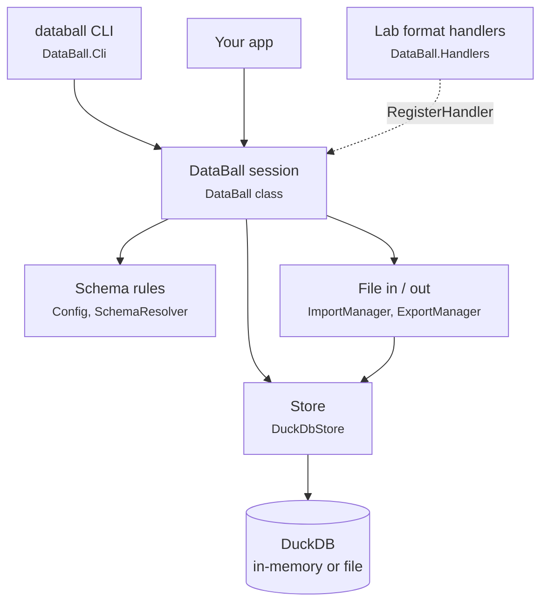

Every session holds two relations: **data** (the rows) and **meta** (key/value constants).

## 2. A session's life

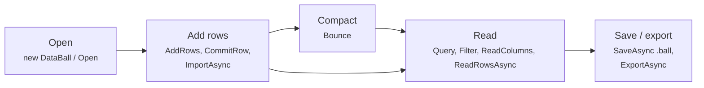

Compacting is optional. `ApplyFilter` limits CSV, Parquet, and archive exports; native saves write the whole session.

## 3. Where the data lives

A non-native `Open` / `OpenAsync` compares input bytes on disk (the sum over every source it opens, each file and directory measured once) with `EngineOptions.InMemoryMaxBytes`: at or below the threshold it uses memory, above it a temporary file. The default threshold is 25% of GC available memory. `StoreMode.Memory` or `File` overrides this choice; an empty constructor starts in memory unless forced to file. Every CLI command applies the same size rule, recursively summing directory inputs; append import counts both inputs. On `import`, `export`, `query`, and `info`, `--store auto|memory|file` selects the rule or forces a store, and `--memory-limit`, `--threads`, and `--temp-dir` forward engine settings. Temporary files live under `TempDirectory` (OS temp by default) and their database, WAL, and default spill directory are cleaned up on disposal or constructor failure; cleanup failures are logged. `MemoryLimit`, `Threads`, and spill `TempDirectory` go through the DuckDB connection builder; null retains engine defaults. Engine options are never persisted in config. Native `.ball` opens ignore mode and threshold but apply the other settings. A `.ball` is a native DuckDB file: open it directly as a read-only session, or request `writable: true`. Save produces a compact whole-session copy. `Open` of a single Parquet file or hive directory attaches a `read_parquet` view without copying rows, unless config declares `tables` or the open has more than one source ([section 14](#14-opening-many-files)). Projection and predicates push through the view to the scan. Store choice still uses source size at open. `ImportAsync` always copies.

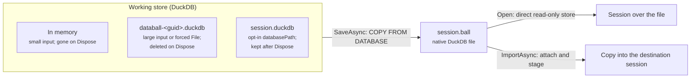

- **Share or move data as `.ball`.** Open it with DataBall or DuckDB; config and metadata travel inside the database.
- **An explicit file-backed working store persists after disposal.** Reopen it with `new DataBall(databasePath: ...)`; its stored config binds the layout. Never point this at `catalog.duckdb`.

## 4. Imports are all-or-nothing

Every import runs inside one transaction. If an import fails, the session is left exactly as it was, including config and metadata. Source: `DataBall.cs` (`RunImport`).

An append or edit to an external Parquet view first materializes it inside the same transaction; a replace drops the view without reading the source. A failed write restores the view. `InitializeRow` validates and materializes in its own transaction before setting pending-row state; later `CommitRow` uses the existing table path. `SetMetadata` does not materialize.

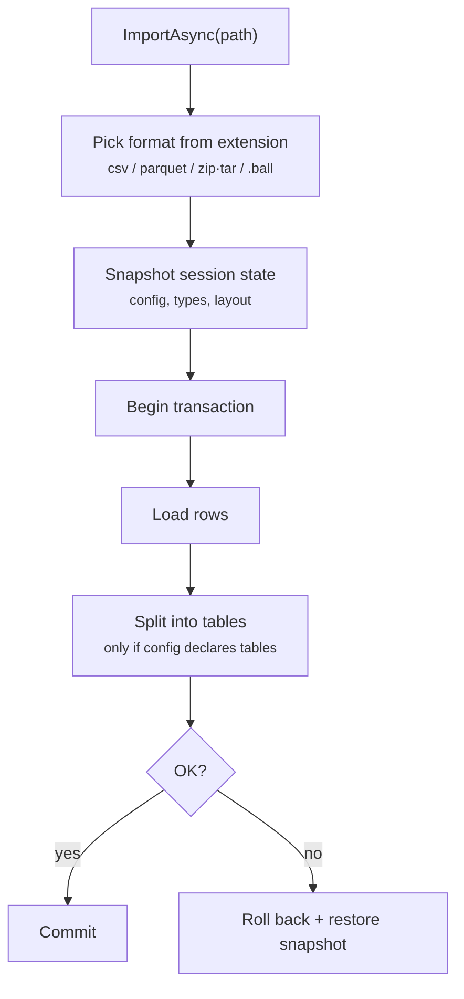

## 5. CSV headers become typed columns

A header such as `EVM(dB)` becomes a column named `EVM` of type double. Source: `HeaderParser.cs`, `SchemaResolver.cs`, `Config.cs`.

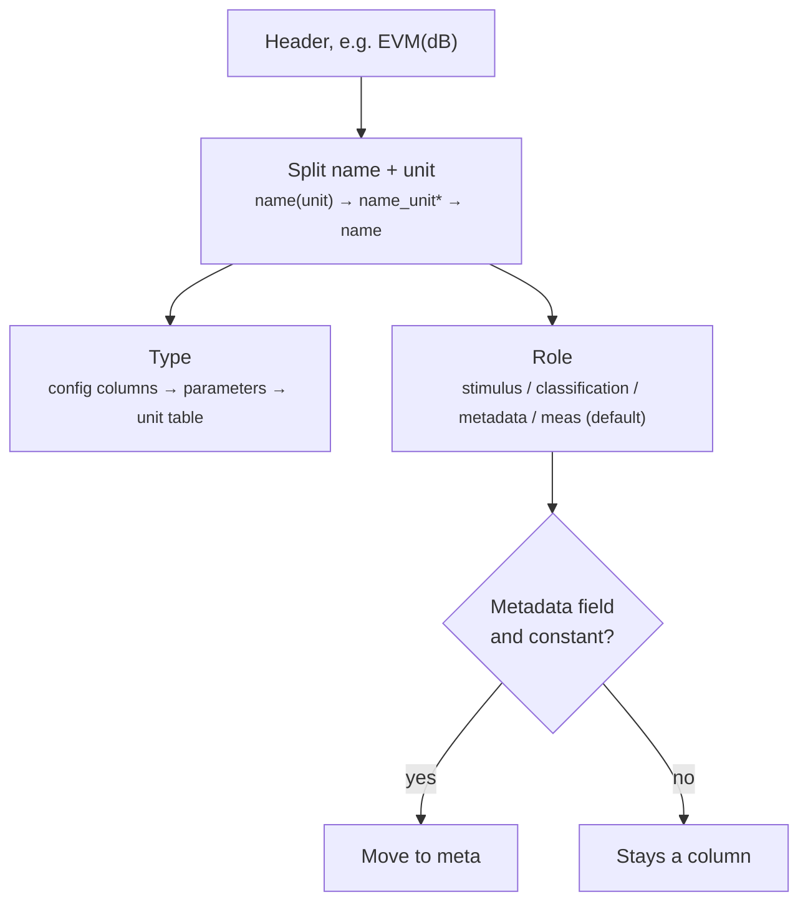

\* `name_unit` splits only when the suffix is a known unit, so `I_Total` stays whole.

CSV and Parquet metadata fields (defaults `Lot`, `Tester`, `Program`) follow `metadataPolicy`. The default `liftConstant` lifts a field with one distinct non-null value, even when some rows are null; varying fields stay columns. Explicit `requireConstant` throws for varying fields. Under `first`, the first value always moves to meta. Parquet keeps source column names and types (DATE becomes TIMESTAMP); it skips CSV header canonicalization and coercion. For a view, extraction reads column aggregates and redefines the projection to exclude extracted fields. CSV imports extract on the staging table before the merge or routing, wide and layout sessions alike (db-26); Parquet extracts after the wide merge, or on staging for a configured layout. On a CSV append, fields already stored in metadata are left for the append reconciliation, which compares canonical names: equal values are ignored, differing values are restored as a column with the old value backfilled (also under `requireConstant`, which still throws when the appended file varies within itself, in wide and layout sessions alike). Under `first` the stored value wins and the appended column is ignored, for every wide append format; the store reads the policy from the session. A field the session already holds as a data column stays data and is never also put in metadata. The backfill `UPDATE`s run after the append's own `ALTER`s, because DuckDB fails the commit when an `ALTER` follows an `UPDATE` of the same table; the ignored source column is dropped with `ALTER TABLE`, never by dropping the table, so a metadata-only file still adds its row with its `_source_key`. `MergeOrAppend` copies without extraction.

## 6. Row builder: carry forward, reset on change

A test executive changes one setup value at a time. `InitializeRow` copies the previous row. When a **trigger** field changes, the row builder clears the fields that depend on it. Source: `DataBall.RowBuilder.cs`.

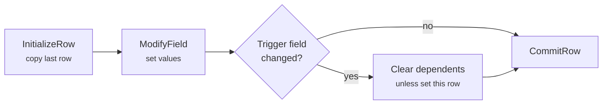

Relationships come from config, for example `{ "trigger": "Name", "reset": ["Age"] }`. `AddRow` / `AddRows` skip this logic and store rows exactly as given.

## 7. Bounce: move constants out, drop duplicates

Source: `DataBall.cs` (`Bounce`). `Squish` is the same call.

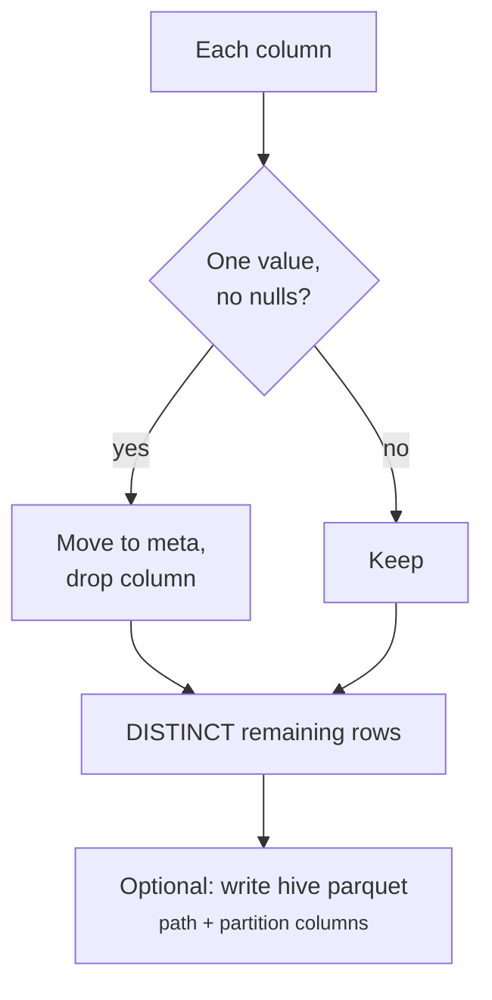

Partition columns, declared table `key` columns and `_source_key` (see [section 12](#12-source-lineage)) are never moved out. Row order is not kept.

## 8. Multi-table layout

With a `tables` section in config, the rows are stored split across several tables. **data** becomes a view that joins them back into the wide shape, so readers never notice. The example below uses the config from the README.

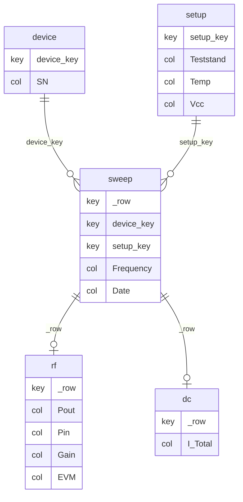

| Kind | Stores | Example |
|---|---|---|
| `master` / `dimension` | each distinct setup once, keyed by a hash of its key columns | `device`, `setup` |
| `rows` (spine) | one row per measurement point: row key `_row` plus dimension keys | `sweep` |
| `measurements` | a column group. Rows where the whole group is NULL are skipped | `rf`, `dc` |

## 9. Writing into a layout

Every write path (import, `AddRows`, `CommitRow`, merge) funnels through one routine. Source: `DuckDbStore.Layout.cs` (`AppendStagingIntoLayout`).

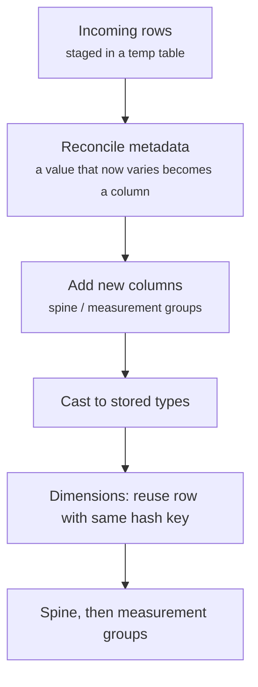

An append that would add a column to a dimension, add a new dimension, or turn varying metadata into a dimension or group column re-splits the session: the layout is materialized wide in row order, the new columns and rows are added, and the result is split again in the same transaction. `_row` is renumbered and dimension keys may change, so neither is stable (a declared-`key` dimension keeps its hash-of-key surrogate; an undeclared-key dimension gets new keys when a column is added). Existing rows get NULL in a new dimension column, so an appended row (including a `CommitRow` copy of the last row) that reuses an existing declared key with a non-NULL value there throws, because the key no longer determines the row; the session is left as it was. The re-split rewrites the whole session, so its cost grows with session size and adding a dimension column mid-capture is expensive; later appends of the same shape take the in-place path.

Append type merge (db-23). `MergedColumnType` gives the type an existing column takes when an incoming type is appended: equal types keep it; two integer types (TINYINT, SMALLINT, INTEGER, BIGINT) widen to the wider one, in canonical spelling; an integer or FLOAT meeting FLOAT or DOUBLE gives DOUBLE; DATE meeting TIMESTAMP (with or without time zone) gives TIMESTAMP; anything else is a conflict (null). `PlanColumnWidening` decides each incoming column that matches an existing one by name, before any change, in this order: the `_source_key` lineage column is skipped; a column whose values cast into the existing type is kept; a column in `configTypes` is kept and casts; an incoming column with no non-null value (`IsAllNull`) keeps the existing type; an empty existing column of any type (`IsAllNull` on its owning table) adopts the incoming type; a widen is recorded; a conflict throws `Cannot append <source>: column '<name>' has type <session type> in the session and <incoming type> in the incoming data`. The source is the quoted path for a file or native `.ball`, `the merged session` for `MergeOrAppend`, and `the appended rows` otherwise. `configTypes` is `DeclaredMergeTypes()`: the expected types that are not learned, plus typed config parameters. Expected types are learned (`_learnedColumnNames`, set by the row builder and the CSV schema pass) or declared (config and `AddColumn<T>`); only declared types are persisted (`ConfigForPersistence`). The wide path (`AppendFromTable`) alters widened columns with `ALTER COLUMN … SET DATA TYPE` and inserts their values without a cast. The layout path (`PlanAppend`, `AppendStagingIntoLayout`) alters the owning physical table and rebuilds the view around it; a widen of a dimension key column to a non-integer type takes `AppendByRematerializing`, which alters the materialized wide column before the re-split recomputes the keys. `_source_key` is excluded. CSV casts the staging table to the expected types before the merge, except that a learned type that is narrower than the incoming column is left uncast when the import merges into a live session (`ImportFromFunction`, `ImportCsvWithSchema`, `ApplyCsvSchema`, through `WidensLearned` and the `merging` flag): the merge then widens the column. First imports and replaces cast as before. The CSV schema runs on staging for wide and layout sessions alike (db-26), so a header-unit column merges into the existing canonical one, and existing columns are not re-cast afterwards: they keep their physical type and this merge rule applies. Parquet and native `.ball` imports do not coerce; their configured columns cast through `configTypes`.

## 10. Whole-table edits on a layout

`AddColumn`, `RemoveColumn`, and `Bounce` all work on the wide shape. On a layout session they unsplit, apply the edit, and re-split, all inside one transaction. Source: `DataBall.cs` (`OnWideData`).

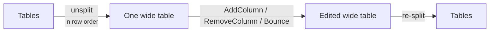

`_row` gets renumbered, so do not treat it as a stable key.

## 11. The .ball file

A `.ball` v3 is a DuckDB database. `Open` checks native magic before handlers, opens read-only by default, reads the latest `_databall` config row, and binds the stored layout. An overlay must describe the same tables. Public write methods reject read-only sessions before changing session state. ZIP `.ball` v1/v2 support is removed.

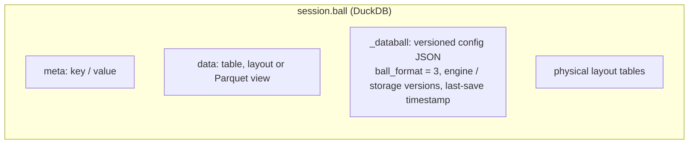

`SaveAsync` ignores session filters and saves all rows. It attaches a temporary destination, uses `COPY FROM DATABASE`, embeds external Parquet views as tables in the saved copy, detaches it, and replaces the destination. When saving to another path, the live view stays attached. A default save by a writable session to its own live path embeds the external Parquet in place before checkpointing. `SaveOptions.Link = true` instead keeps the external view with absolute paths; reopen validates that the source exists and reports its missing path. A linked save to the session's own live path preserves the view and runs `CHECKPOINT`. Filters apply to CSV, Parquet, and archive export.

Native `ImportAsync` attaches the source read-only, merges the schema config subset, stages its wide `data`, routes rows through the existing merge/append path, and loads metadata with config metadata taking precedence. All changes commit together or roll back together. Detach runs after commit or rollback because DuckDB prohibits it while the transaction has outstanding reads.

Config history appends only when merged config changes; the highest version is current. `_databall`, `meta` and `source`, and any name starting with `_source`, are reserved table names. A `.ball` also holds the `source` table and `_source_key` column once a file has been imported ([section 12](#12-source-lineage)). DuckDB's default storage version is retained; no older-engine reader floor is claimed. The same-path in-process gate also applies to read-only opens. A save reserves its destination in that gate, then releases the gate for the copy and removes the reservation after the move, so other sessions' opens, disposes and saves do not wait for it. A second save to that file, or an open of it, while the save is in flight throws at once ("already open") instead of waiting. Readers in other processes use published snapshots ([section 13](#13-live-snapshots)).

Native saves stamp the latest `_databall` row with the running engine's `version()`, the destination's actual `duckdb_databases()` storage tag, and `written_at` (time of that save). The engine and storage versions are read after the database copy and before detach. Saving a writable session to its own file stamps that row before checkpointing. Config history grows only when config changes, including a read-only overlay saved to a copy. A read-only session cannot save to its own path (it throws); save to another path, or open with `writable: true`.

`Open` uses the full stored config; an overlay merges on top and must keep the same table layout (table order does not matter). Stored `meta` values are authoritative on reopen; only overlay metadata overrides them, in memory for a read-only session. Native `ImportAsync` merges only columns, relationships, tables, and config metadata. The receiving session keeps its CSV settings, metadata fields, metadata policy, and other settings.

Dimension-growth re-splits materialize the ordered view once, rename that table to `data`, and use `data` directly as split input. The `_cast` staging table is still a full wide TEMP copy held in memory. Dropped tables are retained until commit, so dropping the source early does not lower the peak inside the transaction. This removes the extra `_unsplit` and `_wide` copies; the whole-session rewrite still runs in one transaction.

## 12. Source lineage

Every file a session opens is recorded in the built-in `source` table, and every row of `data` carries the key of the file it came from. Source: `SourceInfo.cs`, `DuckDbStore.cs` (`AddSource`, `AttachSourceKey`, `ResolveSourceSql`), `DataBall.cs` (`Sources`, `RunImport`).

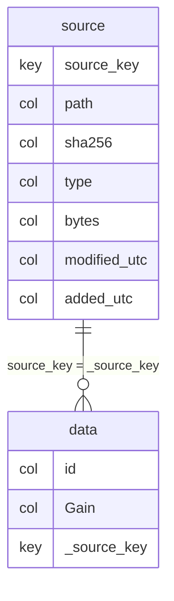

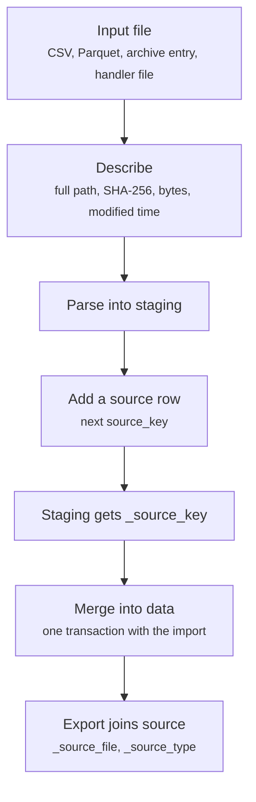

`Open` and `ImportAsync` hash and describe the file before the first write (a hive directory hashes the sorted list of its files' relative paths and hashes); the static `ImportManager` imports and later archive entries do it inside the import's transaction. The `source` row is added once the file has parsed, in the import's own transaction, so a failed import leaves no source behind. A replacing import starts the table over (`RunImport`); an append keeps the earlier keys. In a layout session `_source_key` is an ordinary spine column that survives dimension growth and the unsplit and re-split of `AddColumn` and `Bounce`; `source` is a separate table beside the layout. An external Parquet view carries the key as a constant in its select list (`CAST(1 AS BIGINT) AS _source_key`), which keeps projection and filter pushdown.

`MergeOrAppend` hands the other session over as Parquet without resolving the key, then adds that session's `source` rows after this session's keys and moves the staged `_source_key` values by the same offset. Native `.ball` import does the same from the attached file; a file with no `source` table brings NULL keys. Rows written without a file (`AddRow`, `AddRows`, the row builder) have a NULL key.

Exports wrap the selected rows, including an `ApplyFilter` select, in a `LEFT JOIN` on `source` and write `_source_file` and `_source_type` (and any per-source metadata columns, [section 14](#14-opening-many-files)) instead of `_source_key`, so the file stands alone; a NULL key gives empty values. The `source` table is created by the first import, so a session can have the key column without it (a capture-only `.ball` imported into a fresh session): the export then leaves the key out and writes both columns as NULL. `Bounce` ignores the key when it removes duplicates and keeps the lowest one. An incoming file column named `_source_file` or `_source_type` is renamed `origin_source_*`; any other `_source*` column throws, and so does `_source_key`, except in a native `.ball`, whose keys are remapped, and host writes may not name one either (`Lineage.ThrowIfReservedColumn`). An input that already has an `origin_source_file` or `origin_source_type` column and also brings `_source_file` or `_source_type` fails rather than overwrite it. `SaveAsync` copies the database as it is and keeps `source` and `_source_key`.

## 13. Live snapshots

`PublishSnapshotAsync` gives readers in other processes a closed `.ball` while the writer keeps capturing. Reading the live capture file from another process is not promised.

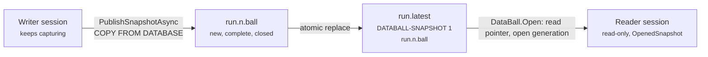

A publish takes these steps, and nothing is written before the guards (open row stream, store transaction, nothing to save, target open in another session) pass:

1. Refuse when `<Name>.latest` exists and is not a snapshot pointer (nothing is written).
2. Choose the generation: one more than the highest `<Name>.<n>.ball` in the directory.
3. Copy through the same core as `SaveAsync`, but into a uniquely named temporary file next to the target, then move it to `<Name>.<n>.ball` without overwriting. The core reserves the target in the open-file set under the process-wide gate and releases the gate for the copy; the reservation ends after the move or on any failure. A view-backed session links its Parquet unless `EmbedViews` is set.
4. Replace `<Name>.latest` atomically: write a uniquely named temporary file (two UTF-8 lines, `DATABALL-SNAPSHOT 1` and the generation file name), then move it over the pointer.
5. Prune generations beyond `Keep`, never the one the pointer names. A delete that fails (a Windows reader holding the file) is skipped and retried at the next publish. If the pointer cannot be read, nothing is deleted.

The capture connection is single, so writes wait during the copy of step 2. A pending `InitializeRow` row is not in the database, so a snapshot holds committed data only.

`ReadSnapshotGeneration(pointerPath)` reads only the pointer and returns the generation number (null when the file is missing; it throws for a file that is not a pointer), so a reader can poll cheaply, reopen only when the number is newer than `OpenedSnapshot.Generation`, and dispose the old session before reopening the same generation in one process. One writer should publish a given `Name`, and any `<Name>.<n>.ball` in the directory counts as a generation. The pointer is UTF-8 without a byte-order mark.

`Open` reads the first bytes of a file before its native-magic check; a file that starts with the magic line is a pointer. It validates line 2 (a bare file name of the form `<something>.<n>.ball`), opens that generation read-only through the native path (so the native and ZIP checks still apply to it) and sets `OpenedSnapshot`. A writable open of a pointer throws. If the pointer vanishes before the retry's second read, `Open` throws a `DataBallException` naming it. If the generation is missing, `Open` reads the pointer once more and retries once, then throws an error naming the pointer and the generation.

## 14. Opening many files

`Open(IReadOnlyList<string>, OpenOptions?)` takes files, directories and globs into one session. A single-path `Open` is the same call. Source: `OpenInputs.cs` (expansion and detection), `DataBall.Open.cs` (`OpenAsync`, `OpenOneAsync`), `DataBall.OpenMany.cs` (staging, `ReconcileSourceMetadata`), `DuckDbStore.Staging.cs` (`BuildDataFromStaged`, `CreateSourceTable`).

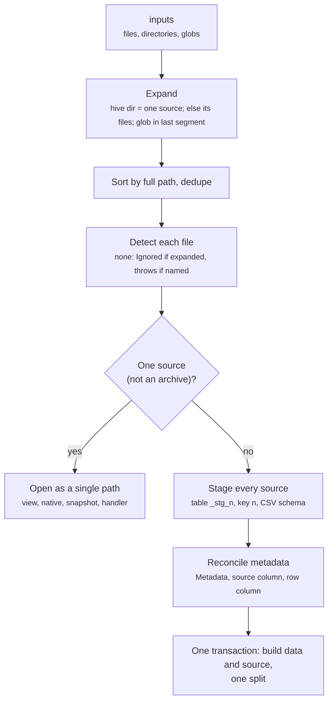

Expansion is deterministic. A directory named as an input is walked once, and only as deep as needed: the top level is listed first, and the tree below it is walked only with `Recursive` or when the top level has no non-stray non-Parquet file. If it holds files and every non-stray file at any depth is `.parquet` it is one hive source, and the list of those files (`HiveFiles.List`, carried on the entry) is what the view, the staging, `SourceFile.Describe` (hash and bytes) and `ImportHiveParquet` all use; otherwise its files are the candidates (the top level only, or all depths with `Recursive`). Stray files are left out of that test (`IsStray(root, file)`): any path segment below the hive root that starts with `.` or `_`, so `.DS_Store`, `_SUCCESS` or `_temporary/0/part.parquet` in a hive directory changes nothing. When the directory expands to files they are not candidates but go to `OpenReport.Ignored`, unless the caller also named them. The hive's list is fixed when it opens: the view's `read_parquet` names those files, so files added later are not seen, including by a `.ball` saved with `SaveOptions.Link`. An only-Parquet subdirectory met while expanding is not a hive source. A pattern's last segment is matched with `FileSystemName.MatchesSimpleExpression` (case-insensitive) against the files of its directory; a `*` or `?` in an earlier segment throws. Candidates are keyed and sorted by full path (ordinal), a file named by the caller replacing the same path expanded from a directory; an entry that another hive entry already reads is dropped, so no file is read twice (`IsReadByAHiveSource`): a file in that hive's list, or a nested hive directory whose files all are. A named stray file the hive leaves out stays an entry of its own. `Classify` reads each one: a snapshot pointer, a native `.ball`, or `Detect`'s report. A report of `None` ignores an expanded file and throws for a named one. The plan carries the summed bytes, so `EngineOptions.ResolveStore(long)` sizes the store over all of them without a second walk; `ResolveStore(IEnumerable<string>)` wraps `UnauthorizedAccessException` and `IOException` in `DataBallException`.

One surviving source that is not an archive takes the single-path route unchanged (`OpenOneAsync`). An archive, alone or not, and several sources take `OpenManyAsync`: a native `.ball`, snapshot pointer or `BallImport` among them throws (naming which it is). `ResolveOpenConfig` serves both routes: each handler's overlay is merged into the defaults in source order, then `schemaPath`; the store is sized over the plan's bytes; each entry gets its handler, source type and route. Staging runs before the import transaction and writes only staging tables (TEMP in a memory store, regular tables in the temporary file store so that they spill to disk), so a failure disposes the session and nothing is left behind (the temporary store, extracted archive entries in `databall-open-*` folders, which are also deleted as soon as an archive's entries are staged). Each source gets key n = its position and the table `_stg_n`: a CSV through `read_csv_auto` with the same header canonicalization, type coercion and learned-type rule as an append (`CanonicalizeCsvStaging`, `merging` true for every source after the first); a Parquet file or hive directory through `read_parquet` (hive: `hive_partitioning = false`) with DATE promoted to TIMESTAMP; an archive's CSV entries extracted by `ImportManager.ExtractCsvEntries` and staged one by one, sorted by entry key; a parsing handler through `StageRows` in batches of 10,000 (no metadata extraction, as for a single handler open).

`RunImport` then runs `MergeStagedSources` in one transaction. `ReconcileSourceMetadata` profiles each staged source once (`COUNT(DISTINCT)`, `COUNT`, `any_value` for every configured metadata field it holds) and decides per field, lowest level winning: a field that varies within any source is left in the staging tables, so the union carries it as a row column; a field constant within each source that has it goes to `Metadata` when every source has it with one value, and to a `source` column otherwise, and its column is dropped from the staging tables. `BuildDataFromStaged` folds the column types across the sources (the `MergedColumnType` rule; a configured column keeps the first source's type; an all-null occurrence adopts the others'; a conflict throws naming the source; one `DecideColumnMerge` ladder shared with the append rule), creates `"data"` from the first source and inserts the rest, dropping each staging table behind it. `CreateSourceTable` creates `source` once with its built-in columns plus the per-source columns and inserts one row per source, because DuckDB fails a commit that alters a table after it deleted or updated rows of it in the same transaction. `RunImport` splits once; `DuckDbStore.LayoutSplits` counts splits and a test pins it at 1 for twenty files that each bring a new metadata key.

`ResolveSourceSql` joins the extra columns of `source` after `_source_file` and `_source_type`, skipping a name the selected rows already have. The typed reads do the same through `ReadScope` in `DataBall.Filter.cs`: when `source` has extra columns and `data` has `_source_key`, `BuildSelectSql` (and so `Filter`, `ReadColumns`, `ReadRowsAsync`, filtered exports) and `Count` read `"data" AS d LEFT JOIN "source" AS s ON d._source_key = s.source_key`, select `d.*` plus the extra columns, qualify every column it names, and let a data column of the same name win; `_source_key` stays. A session without extra columns builds the same SQL as before, so a Parquet view keeps its pushdown. `Query(sql)` stays raw. `RemapStagingSources` and the native import's `BringNativeSources` copy the built-in columns only: a session's per-source columns do not travel through `MergeOrAppend` or a native `.ball` import yet.

An append (`ImportAsync` with `Append`) is not an open, and a per-source column is not metadata: `ExtractConfiguredMetadata` skips a field that is a per-source column of `source`, so it is never lifted to `Metadata`, whether the appended values are constant or vary. The staging column then joins `"data"` as a new column, and `AppendFromTable` (wide), `PlanAppend`/`AppendStagingIntoLayout` (a layout spine column) or `AppendByRematerializing` (a dimension or group column) fill it for the rows already stored with `UPDATE … FROM "source" … WHERE _source_key = source_key` (`BackfillFromSource`), after every ALTER of the append. A file without the field adds no column; the typed reads keep joining the source's value. `ApplyMetadataAgainstSource` and `PlanAppend` still demote a differing stored `Metadata` value to a row column as before. A replacing import drops the `source` table when it has per-source columns (`ResetSources`) and recreates it, since DuckDB cannot alter a table it deleted from in the same transaction.

## Columnar and streaming reads

`ReadColumns(SessionFilter)` and `ReadRowsAsync(SessionFilter, CancellationToken)` build the same parameterized projection and predicates as `Filter`, against the wide `data` relation (joined to the per-source columns of `source` when a many-file open made any, [section 14](#14-opening-many-files)). The existing `Query`, `Filter`, and `Count` paths remain separate. Layout sessions are read through the view. No read order is guaranteed.

A columnar read counts matching rows once, allocates typed arrays using the separate read-side `DuckDbStore.ReadTypeOf` map, and fills them from a reader. `ColumnSet` retains projection order and supports case-insensitive name lookup. Each `ColumnData<T>` exposes `T[] Values` and an optional `bool[] Nulls`; null rows contain `default(T)` and a true mask entry. A column without nulls has no mask. No row dictionaries are materialized for this path. The map is INTEGER/SMALLINT/TINYINT/UTINYINT/USMALLINT → `int`, BIGINT/UINTEGER → `long`, FLOAT → `float`, DOUBLE/DECIMAL/UBIGINT/HUGEINT → `double`, BOOLEAN → `bool`, DATE/TIMESTAMP* → `DateTime`, and UHUGEINT and every other unlisted type → `string` using DuckDB's text form (`CAST(... AS VARCHAR)`). Import typing is unchanged. Arrays above `int.MaxValue` rows are rejected with a limit-specific error.

A streaming read sets DuckDB.NET `UseStreamingMode` and yields a new dictionary per row. The reader and command live until enumeration completes, fails, is cancelled, or is disposed. Cancellation is checked before execution and between rows. The store owns the open-stream count and guards the connection: any call that touches the store while a stream is open throws `DataBallException`. Finish or dispose the enumerator before a call that touches the store. In-memory access to `Metadata`, `Schema` and `CurrentFilter`, and `ApplyFilter(null)`, still works. Disposing the session ends the stream; the next move throws. Both `ReadColumns` and `ReadRowsAsync` execute synchronously on the caller's thread; UI hosts should use `Task.Run`. Sessions remain single-owner and are not thread-safe.

`OpenAsync` drains lab-handler rows through the store's wide append path in batches of 10,000, with a final smaller batch. Each batch is a transaction; a layout session splits once after all batches. An undeclared column inferred as VARCHAR from all-null batches widens automatically when its first non-null value arrives, inside that batch's transaction. Config-typed columns and columns with stored non-null values keep their types. The partial session is never returned on failure: it is disposed, including cleanup of any temporary file-backed store.

## Scored format detection

`OpenAsync` expands its inputs ([section 14](#14-opening-many-files)), then checks each file for a snapshot pointer and native `.ball` magic. It then calls `Detect` before constructing a session. A `FileProbe` holds the bounded head (64 KiB), BOM-aware lines, a delimiter inferred from field-count consistency, literal header fields and file attributes. Parquet magic checks both ends; top-level columns are loaded on first access from `DESCRIBE SELECT * FROM read_parquet(...)` on a short-lived memory connection. The four-byte tail and schema query are the only DataBall reads beyond the head. New lab scorers use the probe; the default interface scorer preserves a legacy handler's full `CanHandle` stream.

JSON types compile to `IFormatHandler` instances. Lazy loading and registration run under `HandlerGate`; the home folder, working-directory folder and explicit registrations override the same id/version in that order. Folder files are validated before changing the registry. `ClearHandlers` clears types and resets the scan. Reports include each handler's score, threshold, priority, reasons and type origin. Directories are never scored by handlers.

Matched weight divided by total weight gives the score; a required miss gates it to zero. Candidates meet their own minimum (default 0.6). Scores within 1e-9 of the highest score are equal, then highest priority wins; a remaining tie is ambiguous. Custom unit-header CSV scores 0.6, allowing more specific types to win. Built-ins are fallback paths, reported as `Generic`, and never compete with scored candidates. Native files bypass handlers; an unknown extension without a candidate is `None`, and so is a delegating winner (a JSON type) on an extension with no built-in path.

After a match, config merges in the order defaults, the winning handler's overlay, then the host's `schemaPath`; an explicit host schema overrides the detected type. The effective config is validated before store selection and passed to the session constructor. A parsing handler uses the existing batched drain; a delegating type uses the existing Parquet view or generic import path. A merged `tables` layout selects copy-and-split instead of a Parquet view. Ambiguity and no match throw with the scoring table before creating a session. The CLI's `detect --explain` prints this same report without importing rows.
